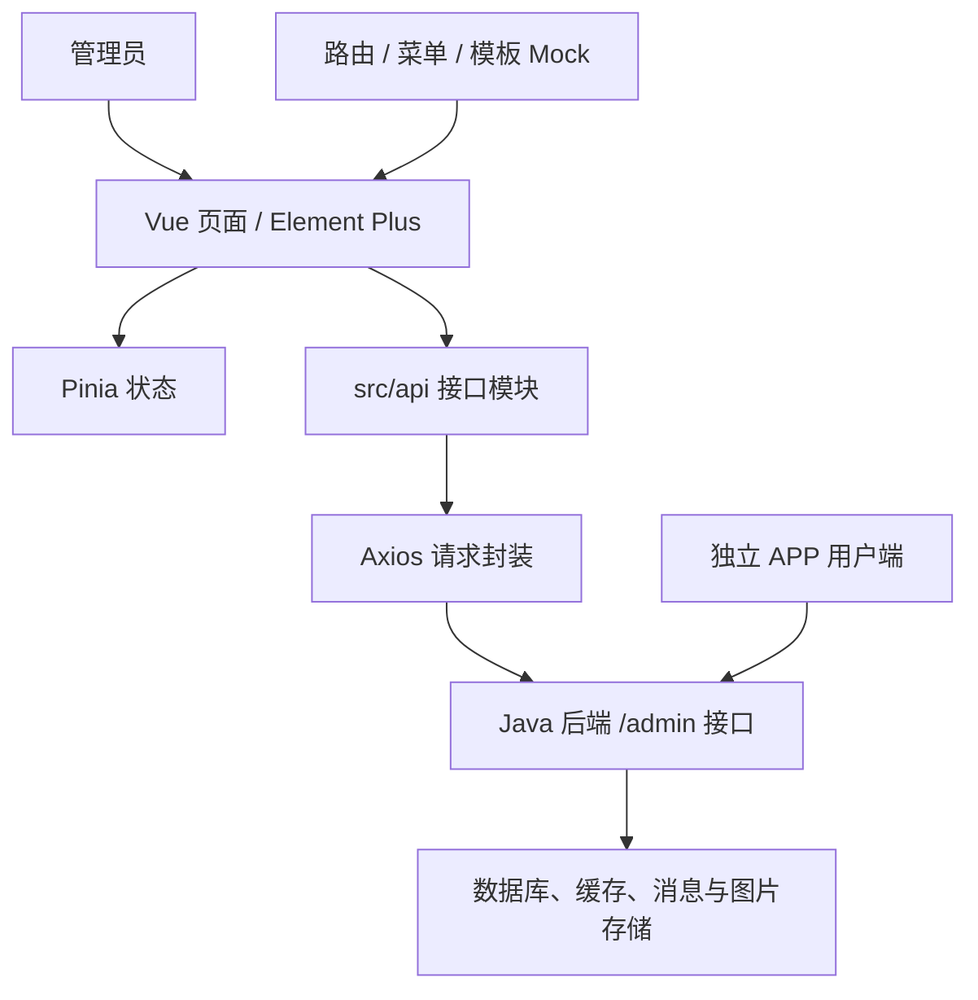

# ShayuVideo Admin · 鲨鱼视频管理后台

ShayuVideo 是一个仿抖音的短视频项目。**本仓库是基于 Vue 3 开发的 Web 管理后台**，用于用户、视频、评论、关注关系、消息、举报申诉及运营数据管理。

本 README 的工程结构、环境配置和运行命令均针对管理后台。业务接口由独立 Java 后端提供，视频浏览与发布由独立 APP 用户端完成。

## 目录

- [项目组成与技术栈](#项目组成与技术栈)
- [架构与工程结构](#架构与工程结构)
- [系统功能框架](#系统功能框架)
- [核心业务流程](#核心业务流程)
- [快速开始](#快速开始)
- [配置说明](#配置说明)
- [构建与部署](#构建与部署)
- [接口联调与状态管理](#接口联调与状态管理)
- [常见问题](#常见问题)
- [功能边界与验证情况](#功能边界与验证情况)
- [原开源项目](#原开源项目)
- [相关文档与协作](#相关文档与协作)
- [许可证](#许可证)

## 项目组成与技术栈

| 工程与仓库 | 定位 | 主要技术 |
| --- | --- | --- |
| [ShayuVideo_admin](https://github.com/tangmyy/ShayuVideo_admin)（本仓库） | Web 管理后台 | Vue 3、Vite、Element Plus、Pinia |
| [ShayuVideo_api](https://github.com/tangmyy/ShayuVideo_api) | Java 后端，提供业务接口 | Java 8、Spring Boot、MyBatis |
| [ShayuVideo_APP](https://github.com/tangmyy/ShayuVideo_APP) | APP 用户客户端 | uni-app、Vue 2、nvue |

| 管理端组件 | 用途 |
| --- | --- |
| Vue 3、JavaScript | 页面与组件开发 |
| Vite 4 | 开发服务器、构建与本地代理 |
| Element Plus | 表格、表单、弹窗及基础交互 |
| Pinia、持久化插件 | 登录信息、主题与页面状态 |
| Vue Router 4 | Hash 路由、动态菜单与导航守卫 |
| Axios | HTTP 请求及请求头处理 |
| ECharts | 统计图表 |
| Mock.js、本地 JSON | 模板中的菜单及按钮权限等模拟接口 |
| Sass、公共布局与组件 | 样式、布局和通用页面能力 |

具体依赖版本以 `package.json` 和实际安装结果为准。原模板介绍中的 Vite 3 不是当前工程的依赖版本。

## 架构与工程结构



开发时 `/admin` 请求通过 Vite 代理转发。生产构建输出静态文件，浏览器不会运行开发服务器的代理配置。

```text
ShayuVideo_admin/
├── src/
│   ├── api/           # 用户、视频、评论、消息等业务接口
│   ├── views/         # 业务页面及保留的模板示例页面
│   ├── components/    # 通用表格、编辑器、消息等组件
│   ├── routers/       # 静态 / 动态路由及导航守卫
│   ├── stores/        # Pinia 状态
│   ├── mock/          # 模板模拟接口
│   ├── assets/        # 图片、图标、本地菜单 JSON 等
│   ├── layouts/       # 页面布局
│   ├── config/        # 主题、缓存、进度条等配置
│   ├── directives/    # 通用指令
│   ├── hooks/         # 公共逻辑
│   ├── languages/     # 国际化资源
│   ├── styles/        # 公共样式
│   ├── utils/         # Axios 封装、环境变量转换及工具
│   ├── App.vue        # 根组件
│   └── main.js        # 应用与插件初始化
├── public/            # 公共静态资源
├── .env               # 通用 Vite 配置
├── .env.development   # 开发模式配置
├── .env.test          # 测试模式配置
├── .env.production    # 生产模式配置
├── vite.config.js     # 构建、代理及插件配置
├── package.json       # 依赖与命令
└── dist/              # 构建产物
```

## 系统功能框架

```text
管理后台
├── 管理员认证
│   └── 登录、退出与登录状态保存
├── 首页统计
│   ├── 账号、点赞、视频、评论、举报等数量
│   └── 活跃用户排行、按月视频发布统计等图表
├── 用户管理
│   ├── 分页、昵称 / 手机号搜索、注册日期筛选
│   ├── 按手机号新增、编辑资料及图片
│   ├── 正常 / 禁言 / 封禁状态设置
│   └── 逻辑删除与恢复
├── 视频管理
│   ├── 分页、标题搜索、作者与互动数据展示
│   ├── 标题、封面地址、播放地址、公开 / 私密设置
│   ├── 审核通过 / 封禁、删除 / 恢复
│   └── 首页视频流排序设置：时间、点赞数、评论数
├── 评论管理
│   ├── 分页、视频 ID / 评论者 ID 筛选
│   ├── 编辑评论、展示父评论与点赞等信息
│   └── 批量屏蔽 / 恢复及选择状态限制
├── 关注关系管理
│   └── 分页、用户筛选、博主 / 粉丝及互相关注展示
├── 消息管理
│   ├── 分页、接收用户筛选、消息内容格式化
│   ├── 编辑、批量删除消息
│   └── 向指定用户发送系统消息、发送系统公告
├── 举报管理
│   ├── 按类型、处理状态及对象筛选
│   ├── 展示举报人与内容详情
│   └── 处理、编辑、重置及相关通知选项
└── 申诉管理
    ├── 按类型、状态、对象与关联举报记录筛选
    ├── 展示申诉人、理由及处理信息
    └── 处理、编辑、重置及相关通知选项
```

用户、视频和评论的状态变化由后端执行。批量操作的实际请求方式、部分失败处理及最终结果，以页面代码与后端响应为准；前端禁用按钮不能替代后端权限校验。

消息页面覆盖关注、视频点赞、视频评论、评论回复、评论点赞、举报处理、申诉处理、系统消息和系统公告等类型。

仓库还保留主题切换、多布局、标签页、表格、指令、办公工具、国际化及数据大屏等模板相关代码。这些示例不等同于鲨鱼视频已接入的业务功能，也不代表整个应用已完成多语言翻译。

## 核心业务流程

### 登录与访问业务页面

```text
输入管理员账号密码 → /admin/login
    → 保存管理员信息与 Token → 初始化菜单 / 动态路由
    → 进入管理页面 → Axios 按配置携带 Token 请求接口
```

导航守卫检查本地 Token，接口层当前发送 `Authorization: Bearer <token>`。是否有权执行具体操作必须由后端验证；本地存在 Token 不代表会话仍有效。

### 视频审核与排序

```text
筛选视频 → 查看内容和状态 → 提交审核通过 / 封禁
    → 后端更新审核与视频状态 → 刷新列表
```

审核状态以与后端一致的值处理：`0` 审核中、`1` 通过、`2` 拒绝 / 封禁。当前后端封禁时将视频设为私密，解封恢复原状态，不据此宣称已经实现“先审后发”。

时间、点赞数、评论数排序是首页列表排序规则，**不等同于 UserCF 个性化推荐**。UserCF 尚未投入实际使用。

### 举报、申诉与通知

```text
查看举报 / 申诉 → 检查关联内容 → 填写处理结果并提交
    → 后端保存处理记录 → 根据选项及业务逻辑发送通知
    → APP 消息页查询结果
```

异步消息由后端 RabbitMQ 消费并写入 MongoDB，管理端不直接连接 RabbitMQ 或数据库，也不据此提供即时推送能力。

## 快速开始

先准备可运行本工程依赖的 Node.js 和 npm。仓库未固定经过验证的 Node.js 版本；首次安装应结合依赖的 engines 要求选择版本，并记录实际验证结果。

```powershell
git clone https://github.com/tangmyy/ShayuVideo_admin.git
cd ShayuVideo_admin
npm install
```

按[后端 README](https://github.com/tangmyy/ShayuVideo_api#readme)准备服务与有效管理员账号，再将 `vite.config.js` 的 `/admin` 代理目标改成自己的后端地址，最后执行：

```powershell
npm run dev
```

浏览器访问终端打印的实际地址。`npm run serve` 也是当前工程中的开发启动命令。仓库没有在本文中提供可用默认管理员密码；请使用自己初始化或管理的账号。

## 配置说明

| 配置入口 | 用途与注意事项 |
| --- | --- |
| `.env` | 应用标题、端口、自动打开、分析报告、Gzip 和日志移除等开关 |
| `.env.development` / `.env.test` / `.env.production` | 对应模式的配置；存在变量不代表已被请求层使用 |
| `vite.config.js` → `server.proxy['/admin'].target` | 开发请求转发地址，当前是固定部署地址，需要替换 |
| `src/utils/service.js` | Axios 的 `baseURL`、超时、认证头和响应处理 |
| `src/routers/`、`src/assets/json/`、`src/mock/` | 菜单、路由与模拟接口来源 |
| `src/stores/` | 管理员信息、会话及主题等状态 |

当前 Axios 的 `baseURL` 为空字符串，使用相对请求路径；`.env` 各模式中的 `VITE_API_URL` **没有在该请求封装中接入**。仅修改此变量不会自动改变开发代理或生产接口目标。

开发代理示例：在 `vite.config.js` 对应位置修改，不是新增第二份配置。

```javascript
"/admin": {
  target: "http://127.0.0.1:8088",
  changeOrigin: true,
  secure: false
}
```

后端地址按实际环境填写。管理端与后端的 `.env` 是不同用途的文件，修改后端 `.env` 不会自动更新前端代理。

不要在前端环境变量中存放数据库密码、腾讯云密钥或 MinIO 服务端私钥。`VITE_*` 配置可能进入浏览器资源，不是服务端秘密存储机制。

## 构建与部署

```powershell
# 开发 / 测试 / 生产模式构建
npm run build:dev
npm run build:test
npm run build:pro

# 本地查看构建产物
npm run preview
```

构建输出到 `dist/`，当前 Vite `base` 为 `./`，路由使用 Hash 模式。发布时需部署静态资源，并明确配置 `/admin` 请求如何到达后端，或者调整请求层基础地址及对应跨域设置。

**开发代理不会随静态资源一起部署**，不能认为执行生产构建后即可访问原代理目标。`preview` 用于本地检查产物，不作为生产服务方案。当前项目也没有已确认的 Nginx 负载均衡部署配置。

如需代码整理，现有 `lint:eslint`、`lint:prettier`、`lint:stylelint` 命令均包含自动修复或写文件操作，执行前确认修改范围；它们不是业务测试。

## 接口联调与状态管理

| 接口前缀 | 管理端用途 |
| --- | --- |
| `/admin/login`、`/admin/logout` | 管理员认证 |
| `/admin/home/*`、`/admin/counts/*` | 首页统计与业务计数 |
| `/admin/users/*` | 用户管理 |
| `/admin/vlog/*` | 视频管理、审核和排序 |
| `/admin/comment/*` | 评论管理 |
| `/admin/fans/*` | 关注关系查询 |
| `/admin/msg/*` | 消息管理与通知发送 |
| `/admin/report/*`、`/admin/appeal/*` | 举报与申诉 |

接口参数、返回数据及状态值以 `src/api/` 和后端 Controller 为准。Axios 当前超时为 5 秒，响应拦截器主要直接返回响应或拒绝错误；不要假设它已经统一处理了所有业务错误或会话失效。

应用入口仍导入 Mock 模块，动态菜单和按钮权限保留模板模拟机制；部分 `/api/*` 请求不属于 Java 后端 `/admin/*` 业务接口。将菜单改为后端权限数据时，需要同步调整路由初始化、Mock 和权限状态，不能将现有机制描述为已实现服务端角色授权。

Pinia 持久化保存管理员及主题等信息，路由也使用 localStorage。排查登录或菜单异常时检查缓存与实际会话，避免将管理员 Token 或用户隐私信息放进日志和截图。

## 常见问题

| 现象 | 排查方向 |
| --- | --- |
| 页面可打开但登录或业务请求失败 | 后端服务、代理 target、账号、浏览器网络请求和响应 |
| 修改 `VITE_API_URL` 后地址没变 | 当前请求层未接入该变量，检查代理和 Axios `baseURL` |
| 开发正常，生产页面请求 404 | 生产环境没有开发代理，需配置实际 API 路径 |
| 页面跳回登录或菜单为空 | Token、持久化缓存、Mock 接口及动态路由初始化 |
| 表格没有数据 | 筛选条件、分页参数、后端响应字段和业务状态 |
| 图片或视频无法显示 | 资源地址可达性、权限、协议及后端返回的 URL |
| 系统通知未显示在 APP | 后端消息发送结果、RabbitMQ 消费、MongoDB 数据与接收用户 |
| 安装或构建失败 | Node.js 兼容性、依赖安装日志、锁文件及本地环境 |

## 功能边界与验证情况

- 本仓库仅为管理端，不直接承载数据库、对象存储或消息队列服务。
- 首页排序配置不是已投入使用的协同过滤推荐；UserCF 尚未实际使用。
- 模板的菜单、按钮显示与导航控制不替代服务端鉴权，不能宣称已完成完整 RBAC 授权审计。
- 保留的模板示例、Mock 数据和上游截图不应作为本项目真实业务运行结果。
- 本次整理基于源码与原功能说明核对，未运行浏览器、构建项目或完成前后端联调；不宣称已通过全量功能和性能测试。

## 原开源项目

本管理后台基于 **vue-diverse-admin** 模板进行业务开发。原开源项目仓库：[https://gitee.com/lin_zi_quan/vue-diverse-admin](https://gitee.com/lin_zi_quan/vue-diverse-admin)。

## 相关文档与协作

- [后端项目与配置说明](https://github.com/tangmyy/ShayuVideo_api#readme)
- [APP 用户端项目](https://github.com/tangmyy/ShayuVideo_APP)

原《系统功能框架说明.md》已合并至本 README。后续修改业务模块、接口和运行配置时，同步维护本文；新增字段或消息类型需要核对三端实现。

提交问题请提供运行环境、复现步骤、预期与实际结果及脱敏日志。后续适合补充本项目真实界面截图、验证过的工具版本、生产部署示例和关键管理链路测试记录。

## 许可证

本项目采用 [MIT License](./LICENSE)。原模板及第三方依赖、组件和素材仍应遵循各自的许可与版权要求。
